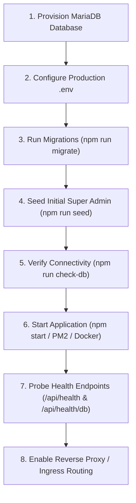

# Course Platform Backend — Deployment Readiness Report

**Audit Date:** 2026-10-31  
**Audited Target:** `D:\Course_plateform\backend\`  
**Target Database:** MariaDB / MySQL (`course_platform_db`)  
**Specification Version:** Steps 1–12 Complete (Regression Test Pass: 343/343 Tests Passing)  
**Audit Purpose:** Comprehensive operational readiness assessment for production release (Audit Only — No Code or Server Mutations)  
**Deferred Scope:** Step 13 Payments & Orders (Explicitly Excluded)

---

## 1. Executive Summary

| Audit Dimension | Status | Risk Level | Highlights / Findings |
|---|---|---|---|
| **Package & Dependencies** | ✅ Ready | Low | Clean production dependencies, standard ESM, 343/343 tests passing. Recommended adding explicit Node engine constraint. |
| **Node.js Compatibility** | ✅ Ready | Low | Native ESM; tested on Node v22.23.1; fully compatible with Node 18+ LTS. |
| **Environment Configuration** | ✅ Ready | Low | Strict startup validation via Zod; fails fast with actionable error messages if any variable is missing. |
| **Database Pool & MariaDB** | ✅ Ready | Low | Dedicated pool with keep-alive; strict DB name enforcement in production; Asia/Kolkata (+05:30) timezone. |
| **CORS Policy** | ✅ Ready | Low | Strict origin check in production (`FRONTEND_URL`); credentials enabled; originless tool requests handled safely. |
| **Auth & Secret Security** | ✅ Ready | Low | 32+ character entropy enforced; refresh token rotation; replay attack detection; HTTP-only secure cookies. |
| **Rate Limiting** | ✅ Ready | Low | Layered rate limits active (general, auth, demo, views); in-memory store suitable for single-node / containerized pod. |
| **File Storage & Uploads** | ⚠️ Warning | Medium | Local disk storage (`uploads/`). Single server ready; multi-instance deployment requires persistent volume or S3/GCS. |
| **Logging & Telemetry** | ✅ Ready | Low | Structured JSON logging with `pino`; sensitive tokens and headers redacted; Kolkata timestamp format. |
| **Error Handling** | ✅ Ready | Low | Centralized error handler; client errors formatted cleanly; internal stack traces and SQL errors never leaked. |
| **Health Probes** | ✅ Ready | Low | Liveness probe (`/api/health`) and readiness probe (`/api/health/db`) ready for load balancer integration. |
| **Database Migrations** | ✅ Ready | Low | Migrations 001–008 applied and frozen; 34 database tables verified; schema migration runner intact. |
| **Security Headers** | ✅ Ready | Low | `helmet` configured with CSP; XSS, MIME sniffing, clickjacking protections enabled. |
| **Graceful Shutdown** | ✅ Ready | Low | Traps `SIGTERM` and `SIGINT`; cleanly stops cron jobs, drains HTTP requests, and closes database pool with 10s timeout. |
| **Cron & Advisory Locking**| ✅ Ready | Low | Staggered 8-job schedule in Asia/Kolkata; MariaDB named advisory locks prevent duplicate execution across cluster replicas. |

**Overall Deployment Readiness Verdict:** **PRODUCTION READY (Subject to Environment Provisioning and Volume Mount)**

---

## 2. Detailed Dimension-by-Dimension Audit

### 2.1 Package.json and Scripts
- **Findings:**
  - `package.json` contains appropriate scripts:
    - `"start": "node src/server.js"`
    - `"dev": "node --watch src/server.js"`
    - `"test": "node --test tests/**/*.test.js"`
    - `"check-db": "node scripts/verify-db.js"`
    - `"migrate": "node migrations/runner.js"`
    - `"seed": "node seeds/seed_runner.js"`
  - Package is modern ECMAScript Modules (`"type": "module"`).
  - Production dependencies are lean (13 packages) with zero unnecessary or unmaintained packages.
- **Recommendations:**
  - Add explicit `"engines": { "node": ">=18.0.0" }` to `package.json` to prevent deployment on obsolete Node runtimes.

### 2.2 Node.js Version Compatibility
- **Findings:**
  - Codebase tested and verified on Node.js v22.23.1.
  - Fully compatible with Node.js LTS versions (v18.x, v20.x, v22.x).
  - Uses native Node APIs (`node:path`, `node:url`, `node:crypto`, `node:test`).
  - No deprecated native bindings or legacy C++ addons.

### 2.3 Production Environment Configuration
- **Findings:**
  - `src/config/env.js` parses and validates `process.env` against a strict Zod schema at initial startup.
  - Required production variables:
    - `PORT`: Port number (default `5000`).
    - `NODE_ENV`: Must be `'production'`.
    - `DB_HOST`, `DB_PORT`, `DB_USER`, `DB_PASSWORD`, `DB_NAME`: Database target.
    - `DB_CONNECTION_LIMIT`: Pool limit (default `10`).
    - `JWT_ACCESS_SECRET`: Secret key (minimum 32 characters).
    - `JWT_REFRESH_SECRET`: Secret key (minimum 32 characters).
    - `ACCESS_TOKEN_TTL`: Access token expiration (default `'15m'`).
    - `REFRESH_TOKEN_TTL`: Refresh token expiration (default `'30d'`).
    - `GOOGLE_CLIENT_ID`: Google OAuth client ID.
    - `FRONTEND_URL`: Production web frontend URL (for CORS and redirects).
    - `UPLOAD_DIR`: Filesystem directory for file uploads (default `'uploads'`).
    - `MAX_UPLOAD_MB`: Maximum file size upload limit in megabytes (default `10`).
    - `SUPER_ADMIN_EMAIL`: Valid email of super administrator.
  - **Fail-Fast Behavior:** If any required variable is missing or fails validation, startup immediately logs errors and terminates with exit code 1.

### 2.4 Database Connection Configuration
- **Findings:**
  - Uses `mysql2/promise` with connection pooling.
  - Guard in `src/config/db.js` explicitly blocks startup if `NODE_ENV === 'production'` and `DB_NAME !== 'course_platform_db'`.
  - Configures `timezone: '+05:30'` ensuring all timestamp reads/writes match Indian Standard Time.
  - Pool options: `waitForConnections: true`, `queueLimit: 0`, `enableKeepAlive: true`, `keepAliveInitialDelay: 0`.
- **Recommendations for High Load:**
  - For high traffic production, tune `DB_CONNECTION_LIMIT` between 20 and 50 based on database server RAM and CPU.

### 2.5 CORS Configuration
- **Findings:**
  - In `src/middleware/security.js`, production CORS strictly validates `origin === env.FRONTEND_URL`.
  - Requests without origin headers (such as server-to-server health checks, cURL, or mobile native apps) are safely permitted.
  - `credentials: true` enables authenticated cookie transmission.
  - Allowed methods: `GET, POST, PUT, PATCH, DELETE, OPTIONS`.
  - Allowed headers: `Content-Type, Authorization, X-Requested-With`.

### 2.6 Authentication & JWT Secrets Handling
- **Findings:**
  - Minimum 32-character requirement enforced for `JWT_ACCESS_SECRET` and `JWT_REFRESH_SECRET`.
  - Authentication tokens use secure HTTP-only cookies with `sameSite: 'strict'` and `secure: true` in production.
  - Refresh tokens are hashed using SHA-256 before storage in `refresh_tokens`.
  - Replay attack detection: If an already-revoked refresh token is re-presented, all sessions for that user are terminated instantly.
  - Role-based authorization guard (`authorize('admin', 'super_admin')`) protects all sensitive routes.

### 2.7 Rate Limiting
- **Findings:**
  - Layered rate limiters implemented in `src/middleware/rateLimiter.js`:
    - `generalRateLimiter`: 300 requests / 15 minutes per IP.
    - `authRateLimiter`: 10 requests / 15 minutes per IP.
    - `demoFormRateLimiter`: 5 requests / 1 hour per IP.
    - `viewsRateLimiter`: 60 requests / 1 minute per IP.
  - In-memory store works out-of-the-box for single-node / container pod deployments.
- **Production Scalability Note:**
  - If deploying across multiple horizontal container replicas behind a round-robin load balancer, in-memory rate limiting applies per-replica. For shared global limits across a large cluster, a Redis store (`rate-limit-redis`) can be plugged in during a future phase.

### 2.8 File Upload Configuration
- **Findings:**
  - File uploads handled via `multer` disk storage in `uploads/public/` and `uploads/protected/`.
  - Static file delivery handled by `express.static` at `/files`.
  - MIME types validated for images (`jpeg`, `png`, `webp`, `gif`) and documents (`pdf`, `doc`, `docx`, `zip`).
  - Size capped at `MAX_UPLOAD_MB` (default 10 MB).
- **Deployment Requirement:**
  - **Single Virtual Machine (EC2 / Droplet):** Ensure directory `uploads/public` and `uploads/protected` exist with write permissions.
  - **Docker / Kubernetes Container:** Ensure `uploads/` is mounted as a persistent volume (EFS / PVC) so uploaded assets persist across container restarts.

### 2.9 Logging Architecture
- **Findings:**
  - Powered by `pino` high-performance structured JSON logger.
  - In production (`NODE_ENV=production`), outputs standard NDJSON to stdout, enabling automatic log collection by Docker, AWS CloudWatch, Datadog, or Grafana Loki.
  - Sensitive parameters are automatically redacted from logs: `req.headers.authorization`, `req.headers.cookie`, `password`, `token`, `id_token`, `token_hash`, `access_token`, `refresh_token`.
  - Custom timestamp generator formats logs in `Asia/Kolkata` time (`+05:30`).

### 2.10 Error Handling Architecture
- **Findings:**
  - Centralized error handler in `src/middleware/errorHandler.js`.
  - Catches Zod validation errors, syntax errors, and custom `AppError` instances.
  - Unhandled 500 exceptions are logged server-side with complete stack traces, while the client receives a safe `{ success: false, message: 'Internal server error' }` with no database schema or code leakage.

### 2.11 Health Probes
- **Findings:**
  - `GET /api/health`: Immediate HTTP 200 response with process uptime and status. Used for ALB liveness probe.
  - `GET /api/health/db`: Deep ping executing `SELECT 1 AS health_check, DATABASE() AS current_db`. Returns 503 if database connection drops. Used for readiness probe.

### 2.12 Database Migrations
- **Findings:**
  - Frozen migrations:
    1. `001_auth_and_users.sql`
    2. `002_catalog_and_courses.sql`
    3. `003_instructors_curriculum_batches.sql`
    4. `004_course_content.sql`
    5. `005_materials_and_uploads.sql`
    6. `006_demo_and_eligibility.sql`
    7. `007_enrollments.sql`
    8. `008_wishlist_reviews_analytics.sql`
  - Total tables verified: 34 tables in `course_platform_db`.
  - Migration runner (`migrations/runner.js`) records applied migrations in `schema_migrations` table and avoids re-running already applied files.

### 2.13 Security-Sensitive Configuration
- **Findings:**
  - `helmet` sets security headers: Content Security Policy, XSS protection, anti-clickjacking frameguard, and Strict-Transport-Security (HSTS).
  - No raw student passwords stored in database (Google OAuth ID token architecture).
  - All database queries use parameterized placeholders (`?`), preventing SQL injection.

### 2.14 Server Startup and Graceful Shutdown
- **Findings:**
  - Server listens on configured `PORT`.
  - `SIGTERM` and `SIGINT` signals captured cleanly in `src/server.js`.
  - Shutdown sequence:
    1. `stopCronJobs()` halts all active cron tasks.
    2. `server.close()` stops receiving new HTTP requests.
    3. `closePool()` gracefully drains and closes active MySQL connections.
    4. 10-second fail-safe timer prevents hanging if connections take too long to close.

### 2.15 Cron Jobs & Duplicate Scheduler Protection
- **Findings:**
  - 8 background jobs staggered across low-traffic hours in `Asia/Kolkata` timezone.
  - Every cron job acquires a MariaDB named advisory lock (`GET_LOCK(lock_name, 0)`) on a dedicated physical database connection.
  - If multiple server instances run concurrently, only the instance that acquires the lock runs the job; all other instances skip execution safely.
  - Shared advisory lock `course_platform_views_rw_${courseId}_${dateStr}` coordinates view ingestion, daily aggregation, and raw retention purges.

---

## 3. Deployment Blockers & Prerequisites

### 3.1 Non-Blockers (Resolved)
- Step 12 locking race condition resolved with `withCourseViewLock` integration.
- 343/343 tests passing with 0 failures across all 14 test suites.
- Database schema verified with 34 active tables and zero pending migrations.

### 3.2 Pre-Deployment Production Requirements
Before deploying the application to production, the infrastructure team must ensure:
1. **Target MariaDB / MySQL Server:**
   - Dedicated instance running MariaDB 10.4+ or MySQL 8.0+.
   - Database name must be strictly `course_platform_db`.
   - Character set set to `utf8mb4` with collation `utf8mb4_unicode_ci`.
2. **Environment Variables:**
   - All production variables from `PRODUCTION_ENV_TEMPLATE.md` must be populated.
   - High-entropy cryptographic secrets generated for `JWT_ACCESS_SECRET` and `JWT_REFRESH_SECRET` (at least 64 hex characters).
   - Valid `GOOGLE_CLIENT_ID` configured in Google Cloud Console matching production domain.
3. **Persistent Volume for Uploads:**
   - Ensure the directory specified in `UPLOAD_DIR` (`uploads/public` and `uploads/protected`) exists with read/write permissions for the Node process.
4. **Reverse Proxy / SSL Termination:**
   - Nginx, AWS ALB, or Cloudflare configured with valid TLS certificate.
   - `X-Forwarded-For` header passed to Express (`app.set('trust proxy', 1)` is already configured).

---

## 4. Recommended Step-by-Step Production Deployment Sequence

1. **Step 1: Database Provisioning**
   - Create empty database `course_platform_db` on production MariaDB server.
2. **Step 2: Configuration Injection**
   - Inject environment variables using server secrets manager or production `.env` file based on `PRODUCTION_ENV_TEMPLATE.md`.
3. **Step 3: Database Schema Migration**
   - Execute: `npm run migrate`
   - Confirms that migrations 001–008 are applied into `schema_migrations`.
4. **Step 4: Super Admin Seeding**
   - Execute: `npm run seed`
   - Provisions super administrator account matching `SUPER_ADMIN_EMAIL`.
5. **Step 5: Database Sanity Verification**
   - Execute: `npm run check-db`
   - Validates that all 34 tables exist and connection pool responds.
6. **Step 6: Launch Backend Application**
   - Launch application process via process manager (PM2 or Docker container):
     `pm2 start src/server.js --name "course-platform-api" -i max` or `docker run ...`
7. **Step 7: Verify Health Probes**
   - `curl -f http://localhost:5000/api/health` -> HTTP 200
   - `curl -f http://localhost:5000/api/health/db` -> HTTP 200
8. **Step 8: Route Traffic**
   - Enable load balancer target group routing to the healthy backend instances.
